# directorio_dolores

# Actividad 4: Consumo de API Local - Directorio Dolorense

## Ronda 1: API local

Servidor funcionando:

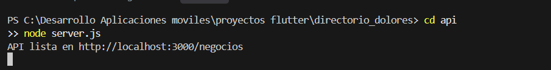

Respuesta de la API:

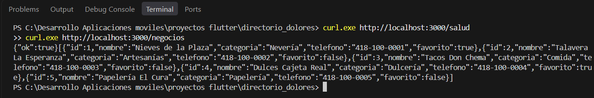

Agregar negocio (POST):

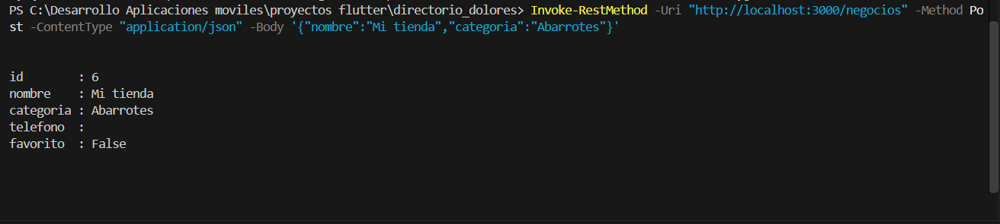

Eliminar negocio (DELETE):

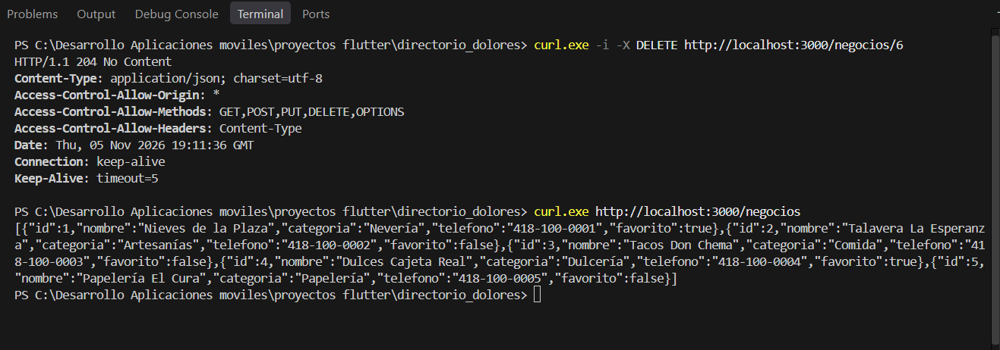

Negocio inexistente (404):

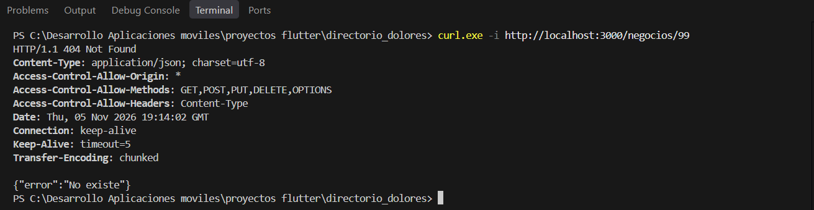

## Ronda 2: Modelo Negocio

Prueba en rojo:

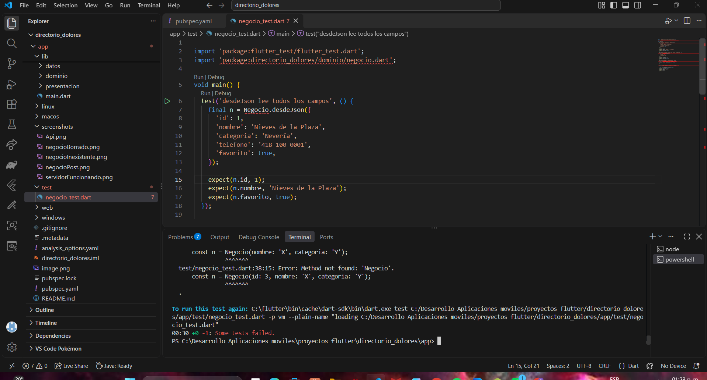

Prueba en verde:

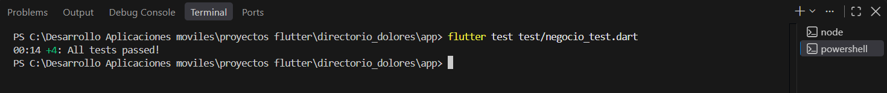

Excepciones:

## Ronda 3: Cliente HTTP con MockClient

Prueba en rojo:

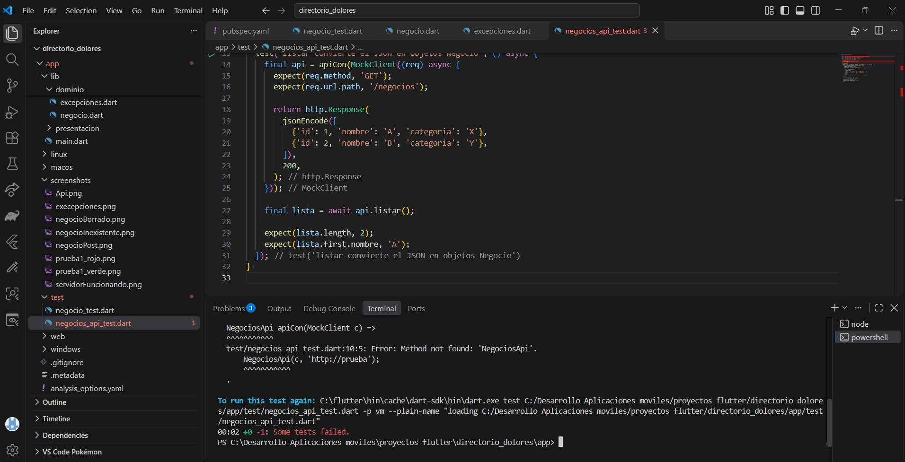

Prueba en verde:

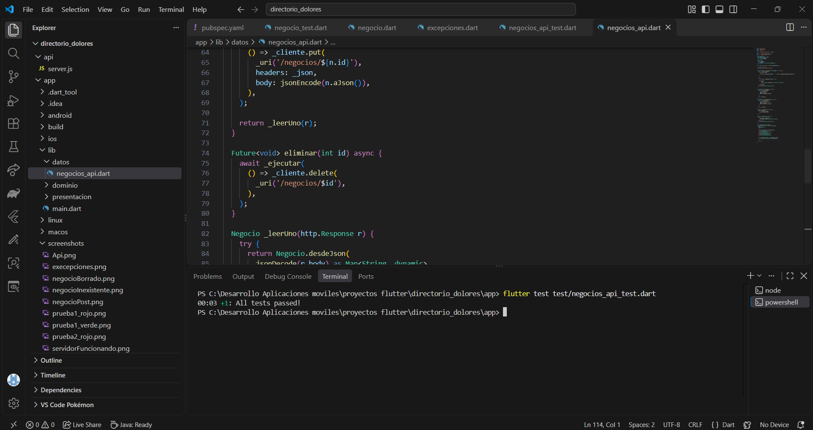

Pruebas de errores HTTP:

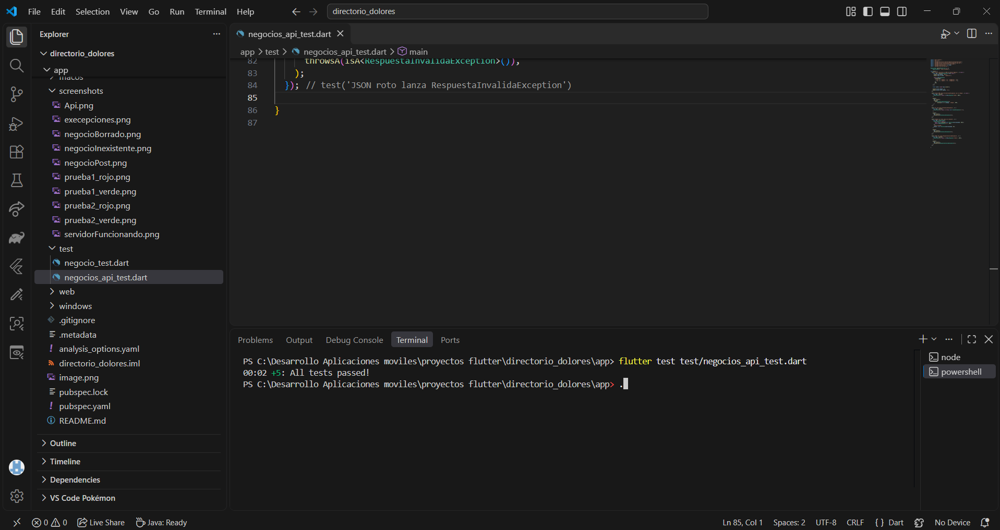

Pruebas POST, DELETE y GET:

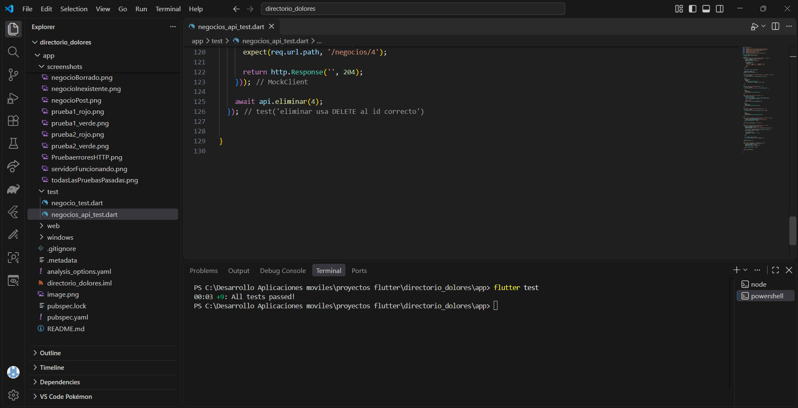

## Ronda 4: Conexión con la API

Configuración de la API:

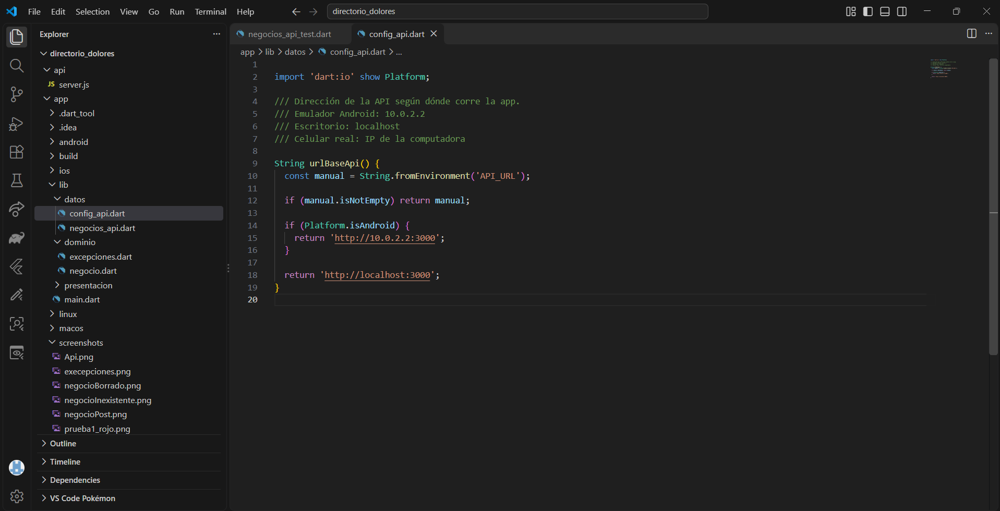

Permisos de Android:

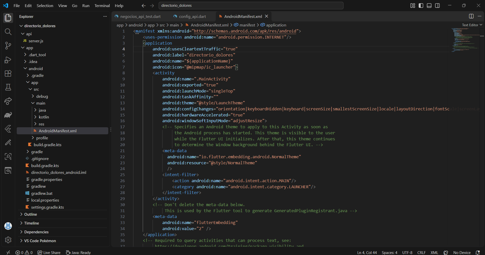

## Ronda 5: ViewModel y estados

Prueba en rojo:

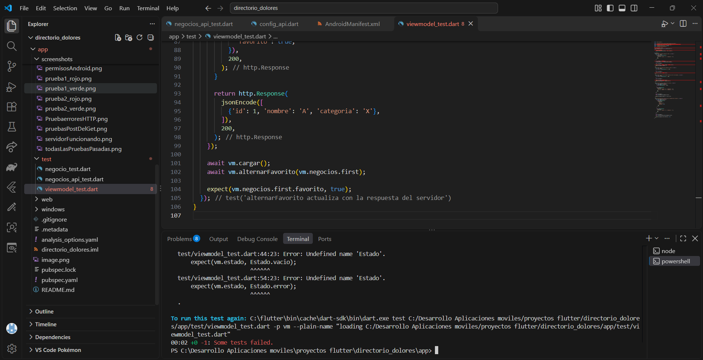

Prueba en verde:

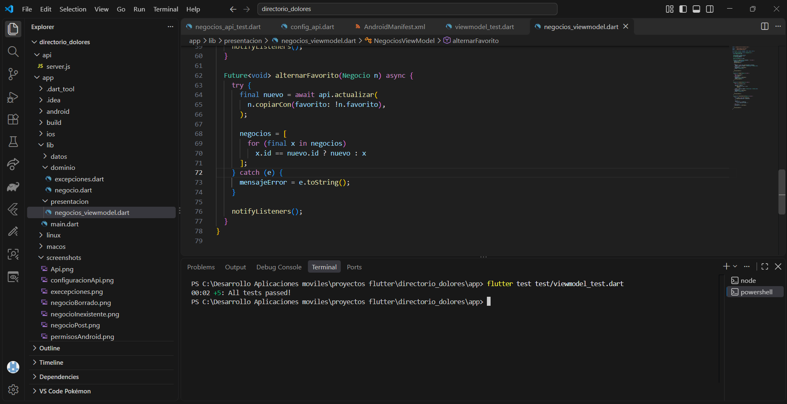

Ronda 5 terminada:

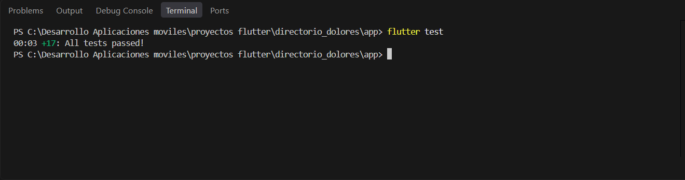

## Ronda 6: Interfaz y pruebas finales

Código de la interfaz:

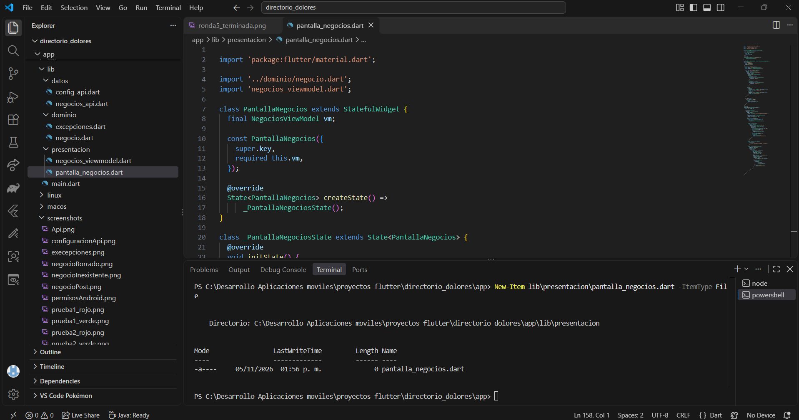

Pruebas finales:

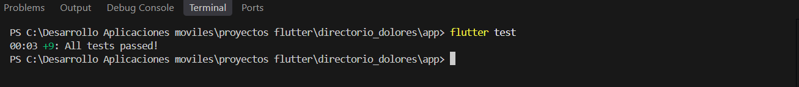
